# toggleboard

[](https://github.com/tenalisriharsha/toggleboard/actions/workflows/ci.yml)
[](LICENSE)


**A feature flag service you can run yourself: turn features on for a percentage of users or for specific groups,
switch them off instantly, and see who changed what.**

A Spring Boot 3 REST API (in-memory or DynamoDB storage), a Java client SDK with local caching and live updates, an
Angular admin console, and Terraform to run all of it on AWS.

- **Boolean and multivariate flags** with weighted variants
- **Percentage rollouts** with stable hashing: the same user always gets the same answer
- **Targeting rules and reusable segments**, evaluated ahead of the rollout
- **Kill switch** per flag, and a **full audit log** of every change
- **Per-environment API keys** and role-based access for the admin endpoints
- **Live updates** over server-sent events; the SDK keeps a local cache and falls back to polling
- **OpenAPI docs** (Swagger UI) and a **Terraform** deployment for ECS Fargate, DynamoDB and CloudFront

## Quick start

You need Java 21 and Maven. No Docker and no AWS account.

```bash
git clone https://github.com/tenalisriharsha/toggleboard.git
cd toggleboard
mvn -q install -DskipTests
mvn -pl toggleboard-api spring-boot:run        # API on http://localhost:8080, Swagger UI at /swagger-ui.html
```

In another terminal, create an environment (the response includes its API key), a flag, and evaluate it:

```bash
curl -s -X POST http://localhost:8080/api/v1/environments \
  -H "Content-Type: application/json" -H "X-Role: admin" \
  -d '{"key":"production","name":"Production"}'

curl -s -X POST http://localhost:8080/api/v1/environments/production/flags \
  -H "Content-Type: application/json" -H "X-Role: admin" \
  -d '{"key":"new-checkout-flow","name":"New Checkout Flow","type":"BOOLEAN","enabled":true,"rolloutPercentage":40}'

curl -s "http://localhost:8080/api/v1/environments/production/flags/new-checkout-flow/evaluate?subjectKey=user-482" \
  -H "X-API-Key: <apiKey from the first response>"
```

## Preview

Every image below is generated by [`scripts/capture`](scripts/capture), which starts the real API and console, creates
the demo data through the API, runs the commands shown and screenshots the results. Nothing is mocked up by hand.

**Swagger UI.** Every endpoint is documented and callable from the browser:


**Create a flag and evaluate it.** A 40% rollout with a targeting rule and a segment, then a decision for one user:

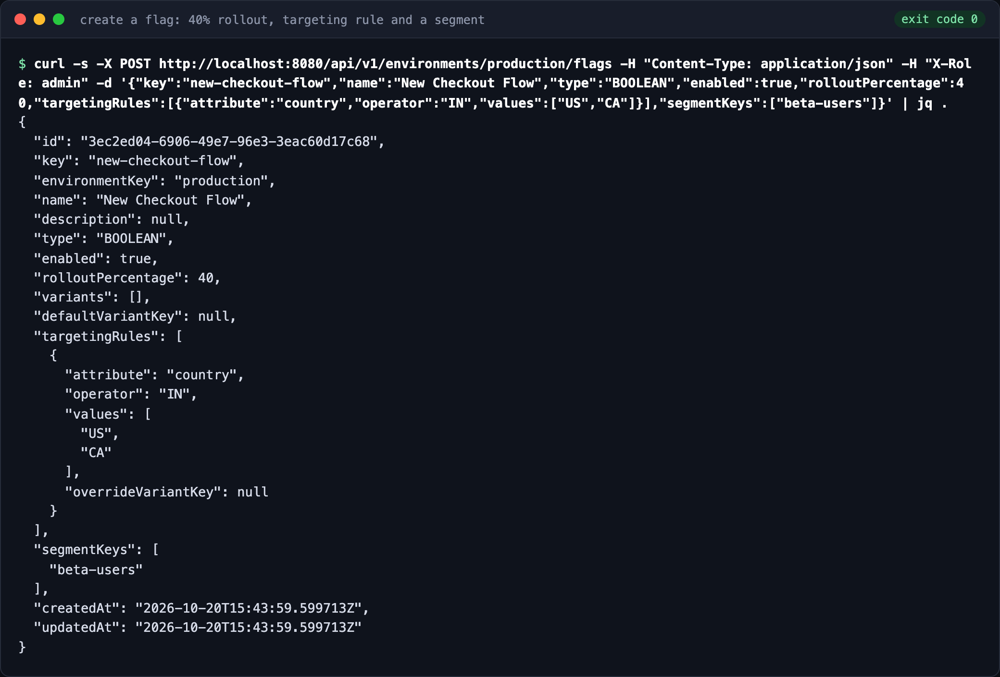
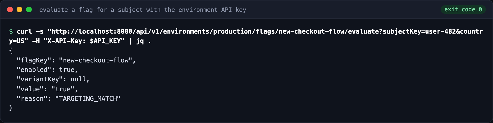

**Data-plane requests need the environment's API key.** Without it the evaluation is rejected:

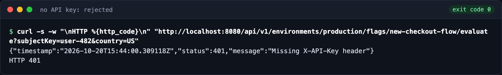

**Stable-hash rollout.** 500 different users against a 40% flag land close to 40%:

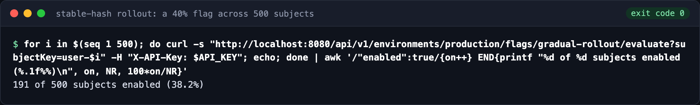

**Audit log.** Every create, update, delete and kill-switch change is recorded, here read through the API:

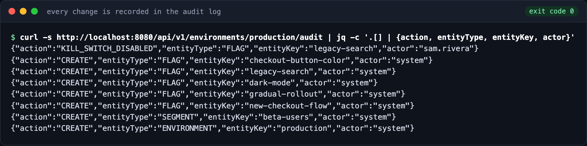

**Admin console.** The flag list with the kill-switch state, a multivariate flag with weighted variants, the segments
list, the audit log with actors, and the environments screen:

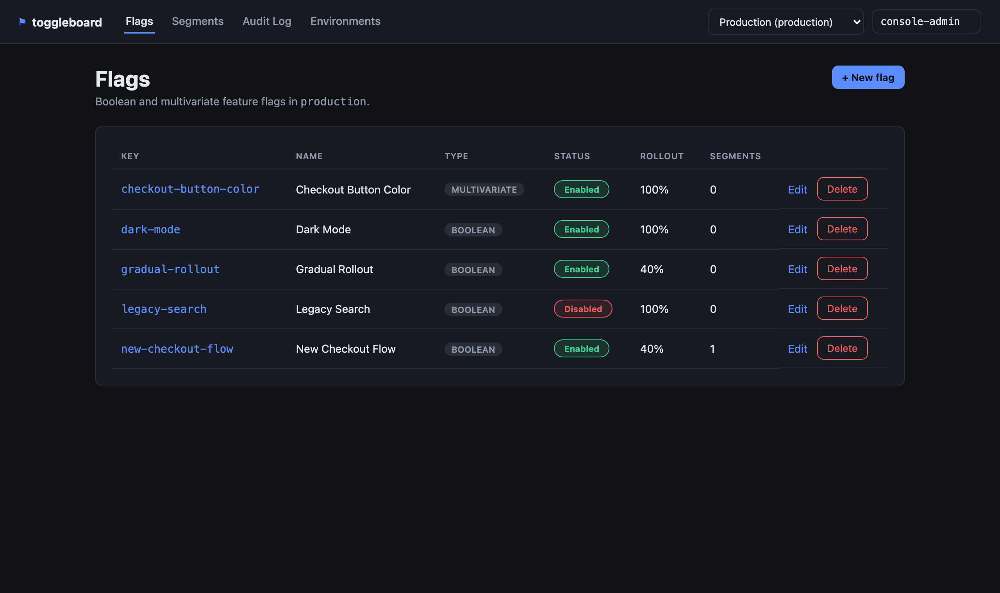
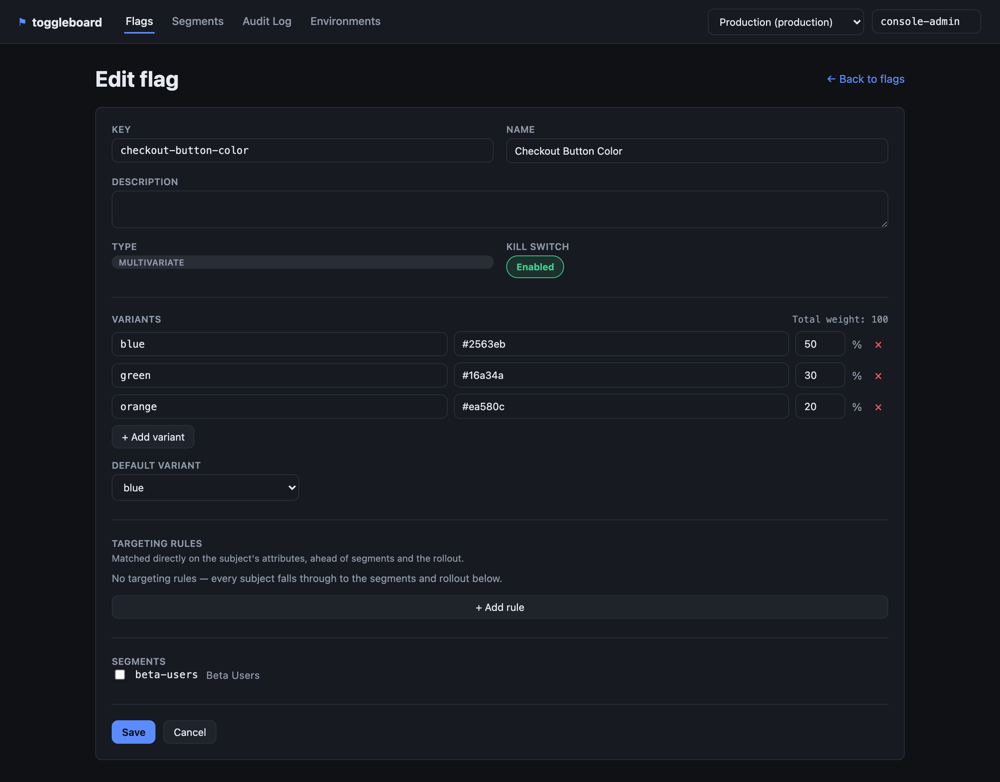
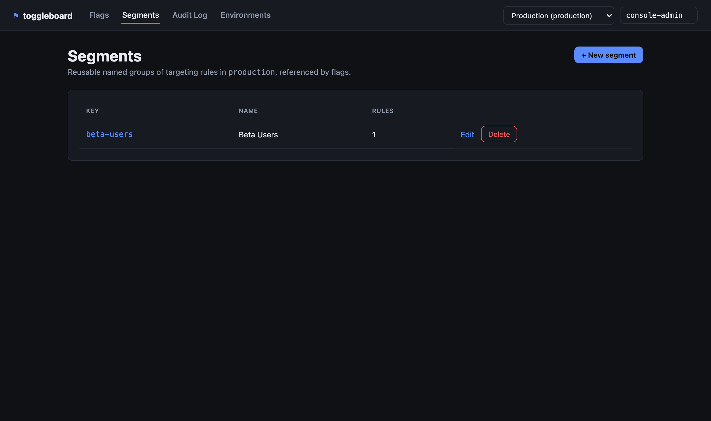
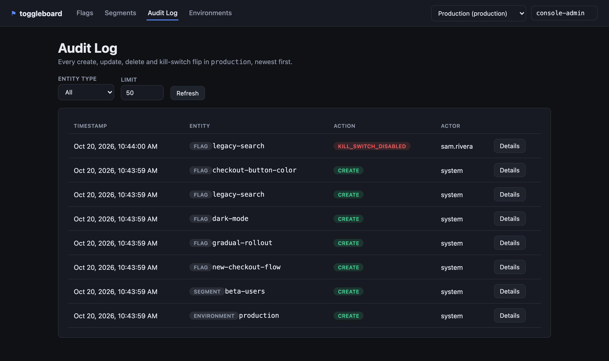
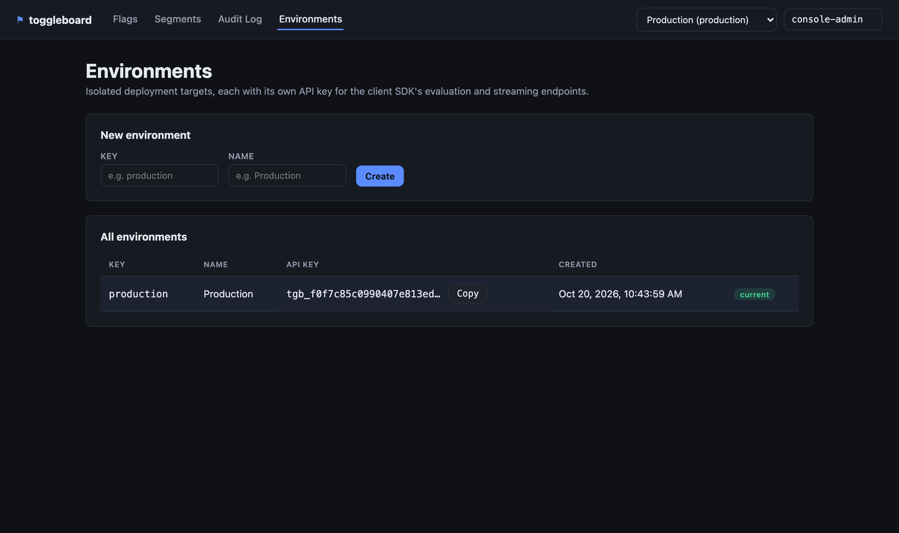

**Infrastructure tests.** `terraform test` checks the AWS setup against a mocked provider, with no account needed:

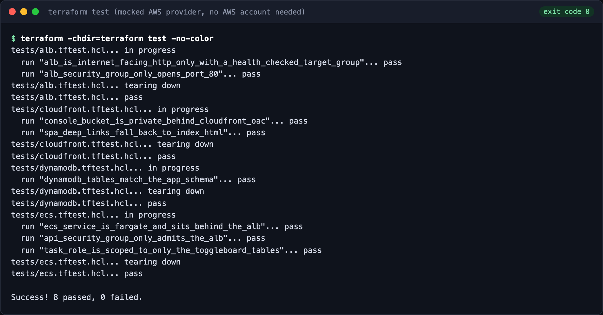

## Architecture

```
toggleboard/
├── toggleboard-api/          Spring Boot 3 REST API (flags, environments, evaluation)
│   ├── domain/                 Flag, Segment, TargetingRule, AuditEntry, FlagEvaluator
│   ├── repository/             Storage interfaces + memory/ and dynamodb/ implementations
│   ├── service/                 Business logic, validation, audit recording
│   ├── web/                    REST controllers + DTOs (including the SSE /stream endpoint)
│   ├── streaming/               FlagChangePublisher: fans out flag-change events over SSE
│   ├── security/               API-key filter (data-plane) + X-Role filter (admin CRUD)
│   ├── config/                  Domain beans, DynamoDB client, CORS for the console's dev server
│   └── exception/               Centralized error handling
├── toggleboard-client-sdk/   Standalone Java client: local cache, SSE push + polling fallback
├── toggleboard-console/      Angular admin console: flags, segments, audit log, environments
│   └── src/app/
│       ├── core/                ApiService, EnvironmentContextService, admin-headers interceptor
│       ├── shared/               TargetingRulesEditorComponent (flags + segments both use it)
│       └── features/             flags/, segments/, audit/, environments/ — one route each
├── terraform/                 ECS Fargate, DynamoDB, ALB, CloudFront for the console
└── docs/screenshots/         Preview images for this README
```

See [PROGRESS.md](PROGRESS.md) for the full breakdown of `toggleboard-api`'s internal
packages and the design decisions behind them.

## Running the API locally

Requires Java 21 and Maven. No Docker and no AWS account are needed either way.

**In-memory storage (default)** — nothing to configure:

```bash
mvn -pl toggleboard-api spring-boot:run
```

**DynamoDB-backed storage** — point it at a real DynamoDB endpoint (or a local one,
e.g. [DynamoDB Local](https://docs.aws.amazon.com/amazondynamodb/latest/developerguide/DynamoDBLocal.html)
or the embedded instance this project's own tests use). Tables are created
automatically on startup if they don't already exist:

```bash
SPRING_PROFILES_ACTIVE=dynamodb \
TOGGLEBOARD_DYNAMODB_ENDPOINT=http://localhost:8000 \
mvn -pl toggleboard-api spring-boot:run
```

Omit `TOGGLEBOARD_DYNAMODB_ENDPOINT` to use the default AWS endpoint and credential
chain for a real deployment. Both modes implement the exact same `FlagRepository` /
`EnvironmentRepository` / `SegmentRepository` / `AuditRepository` interfaces, so the
service layer is identical either way.

The API listens on `http://localhost:8080`. Swagger UI is at
`http://localhost:8080/swagger-ui.html`.

### Quick walkthrough

```bash
# Create an environment (generates its API key) — admin CRUD requires X-Role: admin
curl -s -X POST http://localhost:8080/api/v1/environments \
  -H "Content-Type: application/json" -H "X-Role: admin" \
  -d '{"key":"production","name":"Production"}'

# Create a reusable segment
curl -s -X POST http://localhost:8080/api/v1/environments/production/segments \
  -H "Content-Type: application/json" -H "X-Role: admin" \
  -d '{"key":"beta-users","name":"Beta Users","rules":[{"attribute":"beta","operator":"EQUALS","values":["true"]}]}'

# Create a boolean flag at 40% rollout, targeting US/CA directly and the segment above
curl -s -X POST http://localhost:8080/api/v1/environments/production/flags \
  -H "Content-Type: application/json" -H "X-Role: admin" \
  -d '{"key":"new-checkout-flow","name":"New Checkout Flow","type":"BOOLEAN","enabled":true,"rolloutPercentage":40,
       "targetingRules":[{"attribute":"country","operator":"IN","values":["US","CA"]}],"segmentKeys":["beta-users"]}'

# Evaluate it for a subject — extra query params become targeting attributes
curl -s "http://localhost:8080/api/v1/environments/production/flags/new-checkout-flow/evaluate?subjectKey=user-482&country=US" \
  -H "X-API-Key: <apiKey from the create-environment response>"

# See everything that happened in this environment, newest first
curl -s "http://localhost:8080/api/v1/environments/production/audit"

# Subscribe to live flag-change events (SSE) — same API key as evaluation
curl -s -N "http://localhost:8080/api/v1/environments/production/stream" \
  -H "X-API-Key: <apiKey from the create-environment response>"
```

### Role-based access control

Admin CRUD endpoints under `/api/v1/environments/**` (everything except the
`/evaluate` data-plane, which is guarded by the API key instead) read an `X-Role`
header: `GET` requests need no role at all, but a mutation (`POST`/`PUT`/`DELETE`)
requires `X-Role: admin` — a missing header is `401`, `X-Role: viewer` is `403`. This
is a lightweight placeholder ahead of real identity/authorization in a later phase.

## Admin console

`toggleboard-console` is an Angular 19 app (standalone components, no NgModules) that
talks to `toggleboard-api`'s admin CRUD endpoints directly from the browser — it never
touches the client-SDK data-plane (`/evaluate`, `/stream`), so it never needs an API
key. Every mutating request is automatically sent with `X-Role: admin` and an
`X-Actor` header (editable in the top bar, so the audit log can tell console changes
apart from each other) via an HTTP interceptor; the API's `CorsRegistry` bean allows
the console's dev-server origins (`localhost:4200` / `127.0.0.1:4200`).

Requires Node and npm. With `toggleboard-api` already running on `localhost:8080`
(see above):

```bash
cd toggleboard-console
npm install
npm start   # ng serve — http://localhost:4200
```

The console has no environment of its own to start with — the **Environments** page
lets you create one and copy its generated API key (handy for pointing a `curl` call
or the client SDK at it), and an environment switcher in the top bar controls which
environment the rest of the console (flags, segments, audit log) is scoped to.

## Client SDK

`toggleboard-client-sdk` is a standalone Java module — it depends on nothing but
Jackson for JSON and the JDK's own `java.net.http.HttpClient`, not on
`toggleboard-api`'s classes, so it can be shipped and used independently of this repo.

```java
ToggleboardClient client = ToggleboardClient.create(ToggleboardClientConfig.builder()
        .baseUrl("http://localhost:8080")
        .environmentKey("production")
        .apiKey(apiKey)
        .build());

EvaluationResult result = client.evaluate("new-checkout-flow", "user-482");
// result.enabled(), result.variantKey(), result.value(), result.reason()

client.onFlagChange(notification ->
        System.out.println("flag changed: " + notification.flagKey() + " " + notification.action()));

client.close(); // or use it in a try-with-resources block
```

Every `evaluate()` call hits the REST endpoint directly and caches the result; if that
call fails, the last cached value for the same flag/subject pair is served instead
(an exception is only thrown if there is no cached value at all). A background poller
periodically refreshes every cached entry, and — unless `streamingEnabled(false)` is
set — an SSE subscription to the server's `/stream` endpoint proactively refreshes a
flag's cached entries the moment the server reports a change, with automatic
reconnect and exponential backoff if the connection drops. See
`toggleboard-client-sdk`'s `SdkDemo` (`src/main/java/com/toggleboard/sdk/examples/`)
for a complete runnable walkthrough, and the screenshot above for its output.

## Infrastructure

`terraform/` provisions toggleboard on AWS: `toggleboard-api` on ECS Fargate behind
an internet-facing ALB (target group health-checking `GET /actuator/health`), the
four DynamoDB tables with the same names/keys/GSIs `DynamoDbTableInitializer` creates
at runtime, and a private S3 bucket + CloudFront distribution (Origin Access Control,
SPA deep-link fallback to `index.html`) serving `toggleboard-console`'s static build.
The ECS task role is scoped to exactly those four tables — no `"Resource": "*"`.

**The Terraform has never been applied to a real AWS account.** It is validated with `terraform fmt`/`validate` (both run
clean, no formatting diffs) and a `terraform test` suite (`terraform/tests/*.tftest.hcl`)
run against `mock_provider`, which exercises the full plan/apply graph without ever
calling real AWS:

```bash
cd terraform
terraform init
terraform fmt -check -recursive
terraform validate
terraform test
```

See [terraform/README.md](terraform/README.md) for the full file-by-file breakdown
and what each test asserts.

## Testing

```bash
mvn test                                    # toggleboard-api + toggleboard-client-sdk
cd toggleboard-console && npm test -- --watch=false --browsers=ChromeHeadless
cd terraform && terraform test              # infrastructure, against mock_provider
```

152 tests in `toggleboard-api` + 6 in `toggleboard-client-sdk` + 38 in
`toggleboard-console` (196 total), plus 8 Terraform test assertions:

- **`toggleboard-api`**: stable-hash rollout determinism and distribution, flag
  evaluation (kill switch, targeting rules, segment matching, boolean rollout,
  multivariate variant selection and overrides), repository CRUD for every entity
  against **both** the in-memory and the DynamoDB-backed implementations (via embedded
  DynamoDB Local — no Docker), service-layer validation and audit recording, MockMvc
  integration tests for every REST endpoint (including the API-key filter's and the
  `X-Role` filter's 401/403 paths, the SSE stream's async lifecycle, and the CORS
  preflight the console's dev server relies on), a hand-rolled evaluation-latency
  benchmark and concurrent load test (see the screenshots above for sample numbers),
  and that `GET /actuator/health` is reachable with no auth for the ALB health check.
- **`toggleboard-client-sdk`**: its own tests against an in-process JDK `HttpServer`
  (evaluation, caching/fallback, polling, SSE push and reconnect — no Spring context
  needed), plus an end-to-end integration test (in `toggleboard-api`) that runs the
  SDK against the real running server.
- **`toggleboard-console`**: Karma/Jasmine unit tests (headless Chrome) for every
  component and service — API URL construction, the environment-context service's
  current-environment and actor persistence, the shared targeting-rules editor's
  add/remove/value-parsing logic, each feature's form validation (e.g. a multivariate
  flag whose variant weights don't sum to 100 is rejected before the API is even
  called) and its HTTP interactions, mocked with `provideHttpClientTesting()`.
- **`terraform`**: a `terraform test` suite (`mock_provider`, no real AWS calls) that
  asserts the DynamoDB tables' keys/GSIs match the app's own schema, the ECS service
  is genuinely Fargate with its task role scoped to only those four tables, the ALB's
  listener/health-check/security-group config, and that the console's CloudFront
  distribution is private-behind-OAC with a working SPA fallback.

To regenerate the screenshots: `cd scripts/capture && npm install && npm run capture` (needs Java 21, Maven, Node,
Terraform and `jq`).

## Project status

Version 0.1. The phase-by-phase build history, design decisions and known limitations are in
[PROGRESS.md](PROGRESS.md) and [DAILY_REPORT.md](DAILY_REPORT.md).

## License

[MIT](LICENSE)
