# toggleboard

A feature flag service: a Spring Boot 3 REST API backed by DynamoDB, with boolean and
multivariate flags, percentage rollouts via stable hashing, targeting rules and
segments, a kill switch, role-based access control, and a full audit history of every
change. It ships a Java client SDK with local caching and streaming updates (SSE), an
Angular admin console, per-environment API keys, OpenAPI docs, and Terraform to run it
all on AWS.

## Project Status

Built in public across a 5-session sprint. See [PROGRESS.md](PROGRESS.md) for the
full architecture, phased build plan, and exactly where work resumes next session.

**Session 1 of 5 — Foundation: done.** Core domain model, stable-hash rollout engine,
in-memory storage behind repository interfaces, the flags/environments REST API,
per-environment API key auth on the evaluation endpoint, OpenAPI docs, and 56 passing
tests.

**Session 2 of 5 — Persistence, targeting & audit: done.** A real DynamoDB-backed
`FlagRepository`/`EnvironmentRepository`/`SegmentRepository`/`AuditRepository`
(switchable via the `dynamodb` Spring profile, same interfaces the in-memory repos
implement), targeting rules and reusable segments evaluated ahead of the percentage
rollout, a full audit log of every create/update/delete/kill-switch-toggle, a
lightweight `X-Role` RBAC layer on the admin CRUD endpoints, and 131 passing tests
(including real round-trips against embedded DynamoDB Local — no Docker required).

**Session 3 of 5 — Client SDK & performance: done.** A standalone `toggleboard-client-sdk`
Java module (only Jackson + the JDK's own `java.net.http.HttpClient` — no dependency on
`toggleboard-api`'s classes) that evaluates flags, caches results locally, and keeps
them fresh via a background poller and an SSE subscription with automatic reconnect;
a new `/stream` SSE endpoint on the server that pushes a `flag-change` event on every
create/update/delete; a hand-rolled p50/p99 evaluation-latency benchmark (both
in-process and full REST round trip); and a concurrent load test against the
evaluation endpoint. 149 tests in `toggleboard-api` + 6 in `toggleboard-client-sdk`
(155 total), including a real end-to-end integration test that runs the SDK against
the actual running server.

## Preview

**Swagger / OpenAPI docs** — every endpoint is documented and callable from the browser.

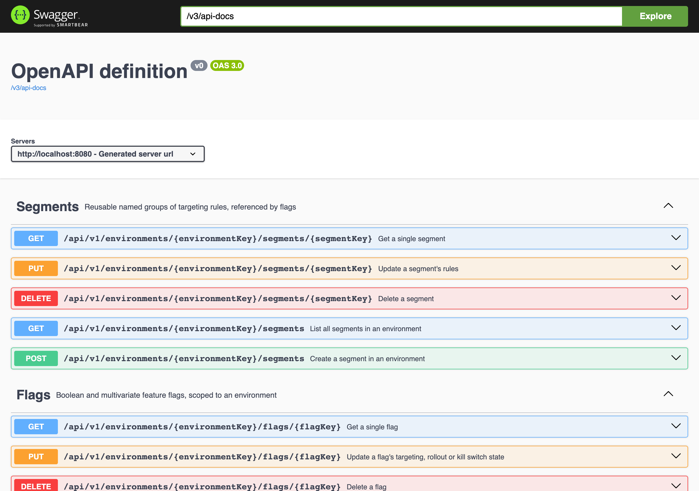

**Evaluation endpoint detail** — the client SDK data-plane: resolve a flag for a subject.

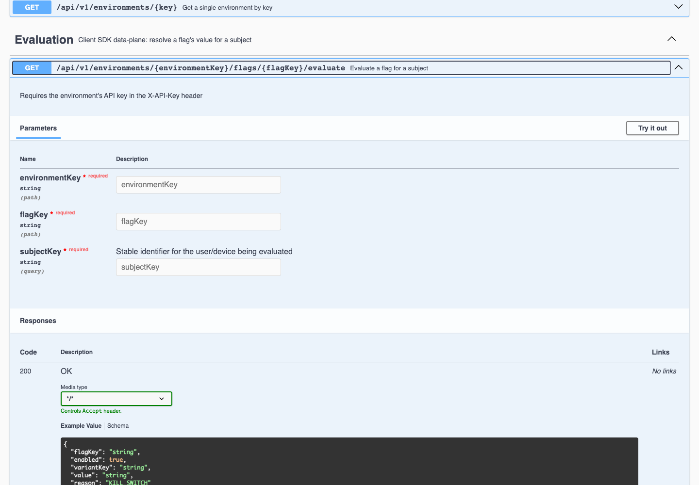

**Creating an environment and a flag** — environments get an auto-generated API key;
flags are created with a rollout percentage.

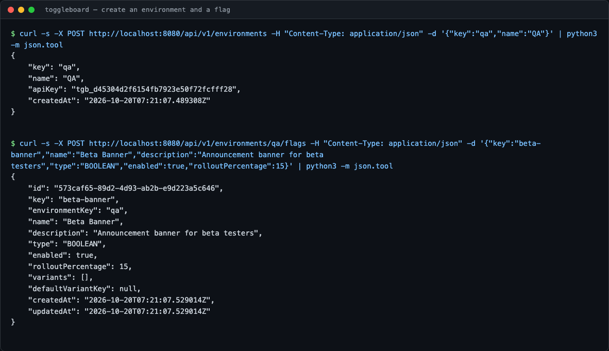

**Listing flags** — boolean, multivariate (with weighted variants), and a
kill-switched flag, all in one environment.

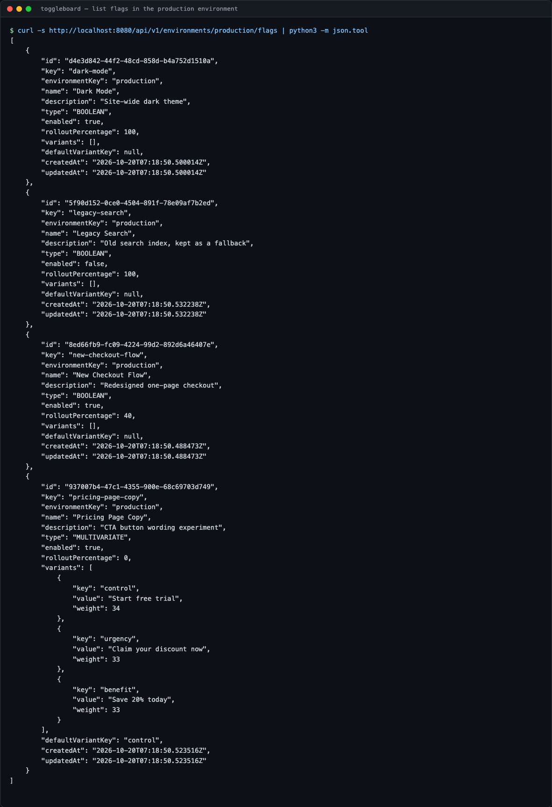

**Evaluation, API key auth, and the kill switch** — a valid key gets a decision, a
missing key is rejected with 401, and a disabled flag always resolves to `false`
regardless of its rollout percentage.

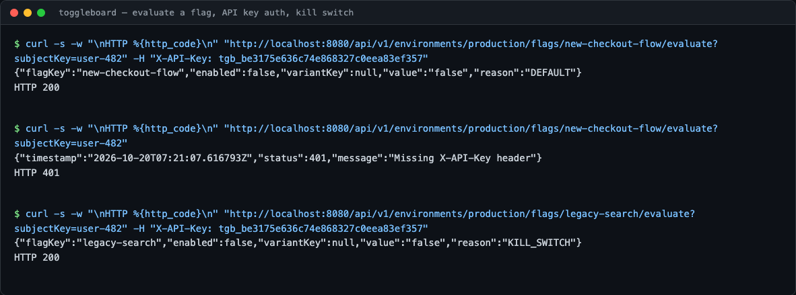

**Stable-hash rollout in action** — 500 distinct subjects evaluated against a flag
with `rolloutPercentage=40`; the observed rate lands within a couple points of target.

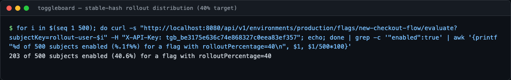

**Targeting rules and segments** — a reusable segment, and a flag that targets
`country IN [US, CA]` directly and also references that segment.

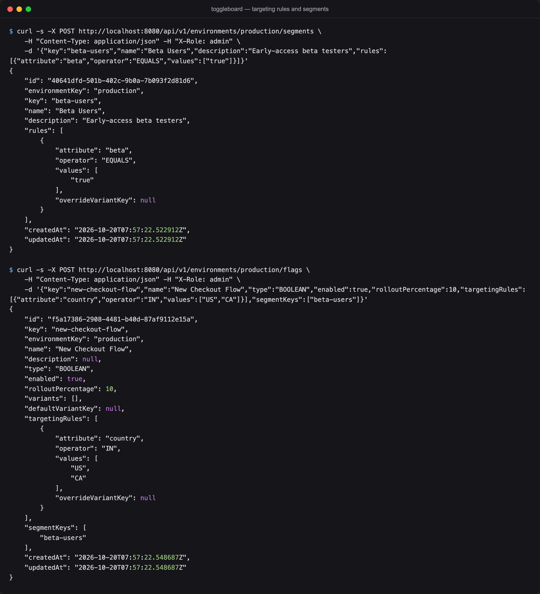

**Evaluation reasons** — the same flag resolving three different ways for three
different subjects: a direct targeting-rule match, a segment match, and the default
rollout fallback when neither matches.

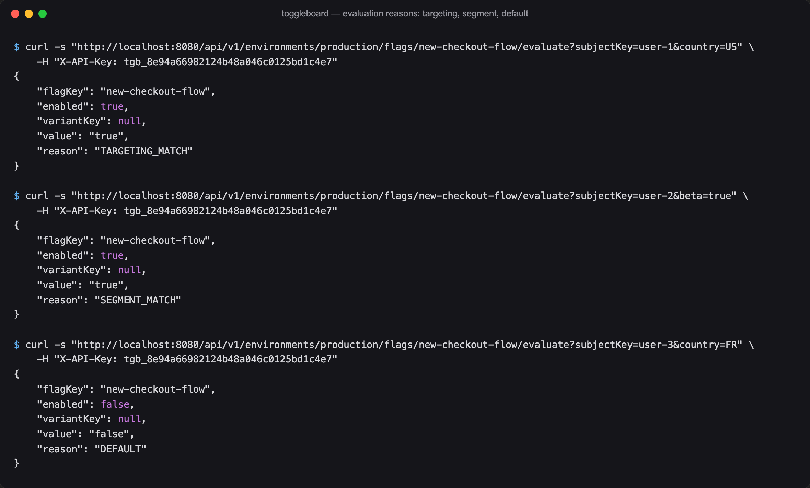

**Kill switch toggle and the audit log** — disabling a flag records a
`KILL_SWITCH_DISABLED` entry (not just a generic update) with who did it and the
full before/after snapshot.

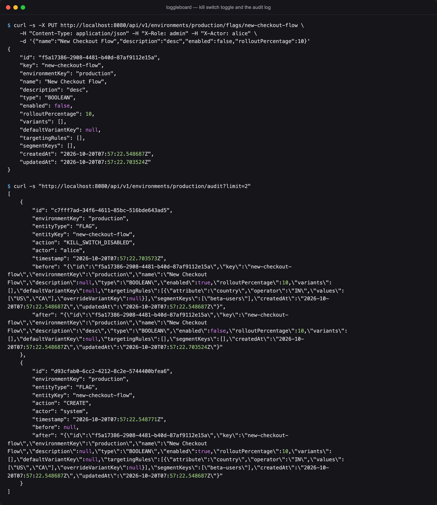

**Role-based access control** — a mutating request with no `X-Role` header is
rejected with 401, a `viewer` gets 403, an `admin` succeeds, and reads never require
a role at all.

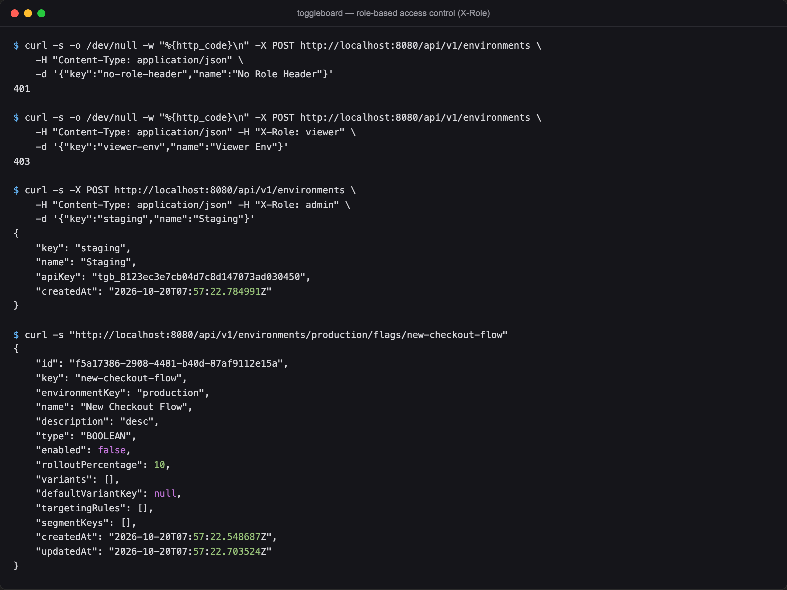

**Full test suite** — 131 tests across the domain, repository (in-memory and
DynamoDB), service, and web layers.

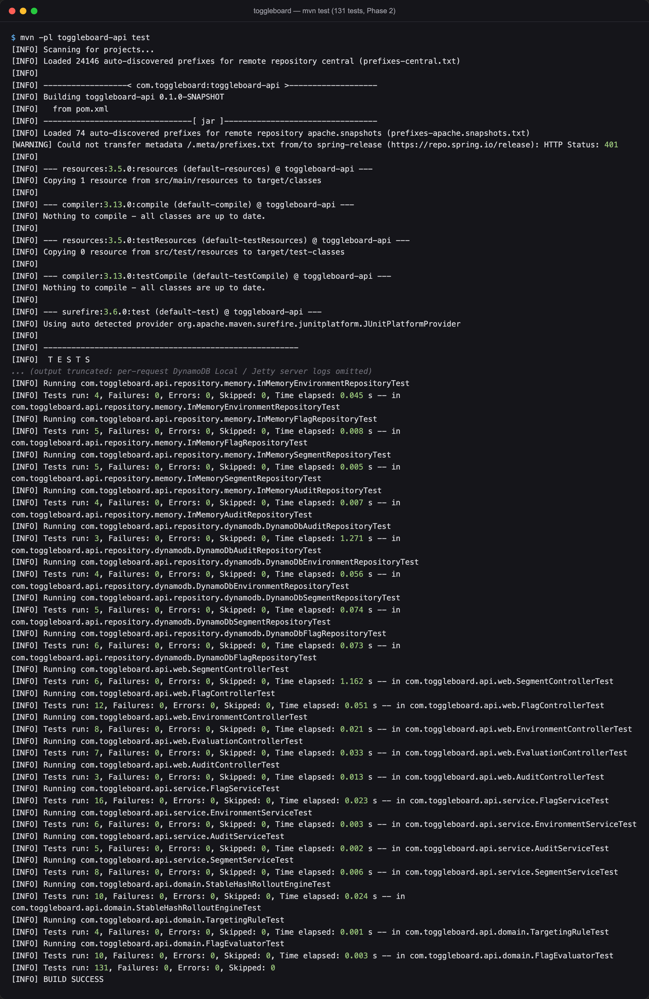

**Running on the `dynamodb` profile** — the exact same API, backed by a real
DynamoDB client instead of the in-memory repositories.

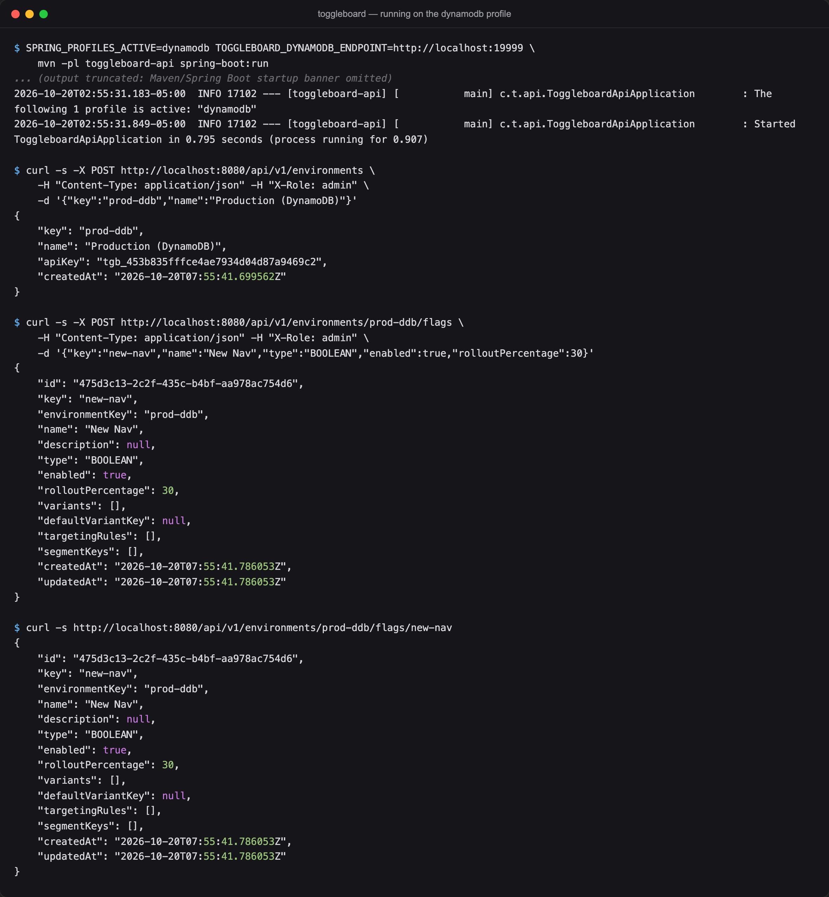

**The client SDK end-to-end** — `toggleboard-client-sdk`'s `SdkDemo` creates an
environment and flag through the admin API, evaluates the flag through the SDK, then
watches a live SSE push notification arrive the instant an admin flips the kill
switch — the cache refreshes itself automatically, no explicit poll needed.

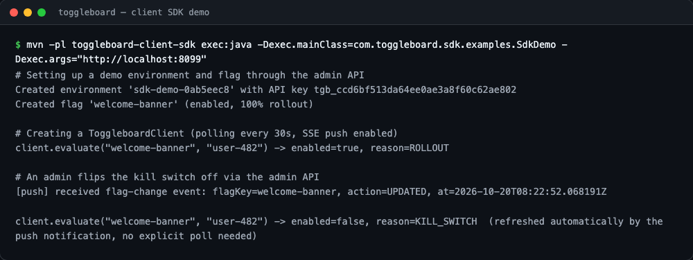

**Evaluation-latency benchmark** — p50/p99 for `FlagEvaluator.evaluate()` directly
(sub-microsecond) versus the full REST round trip over localhost (sub-millisecond).

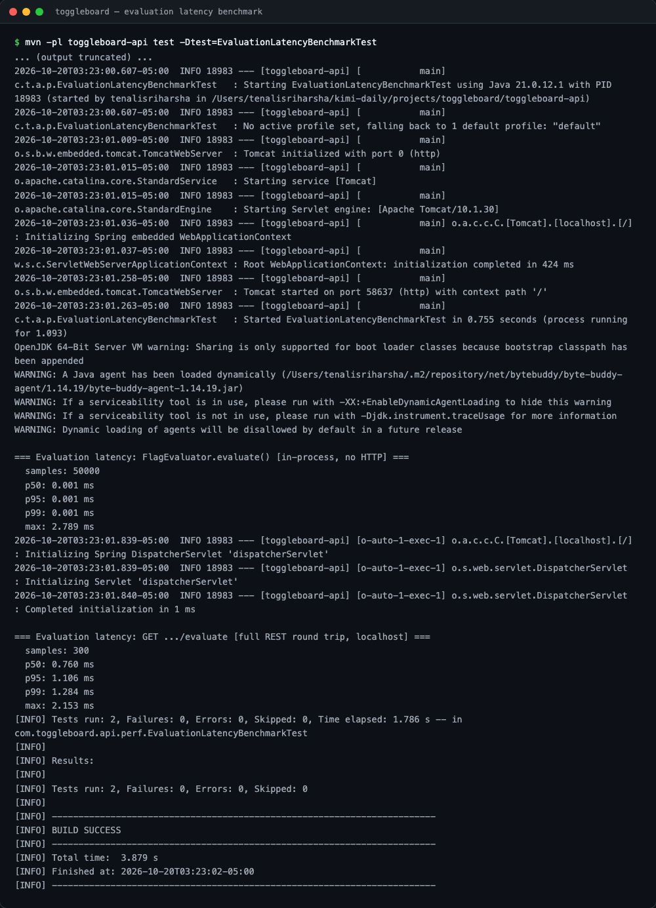

**Concurrent load test** — 20 threads firing 1,000 requests at `/evaluate` with zero
failures.

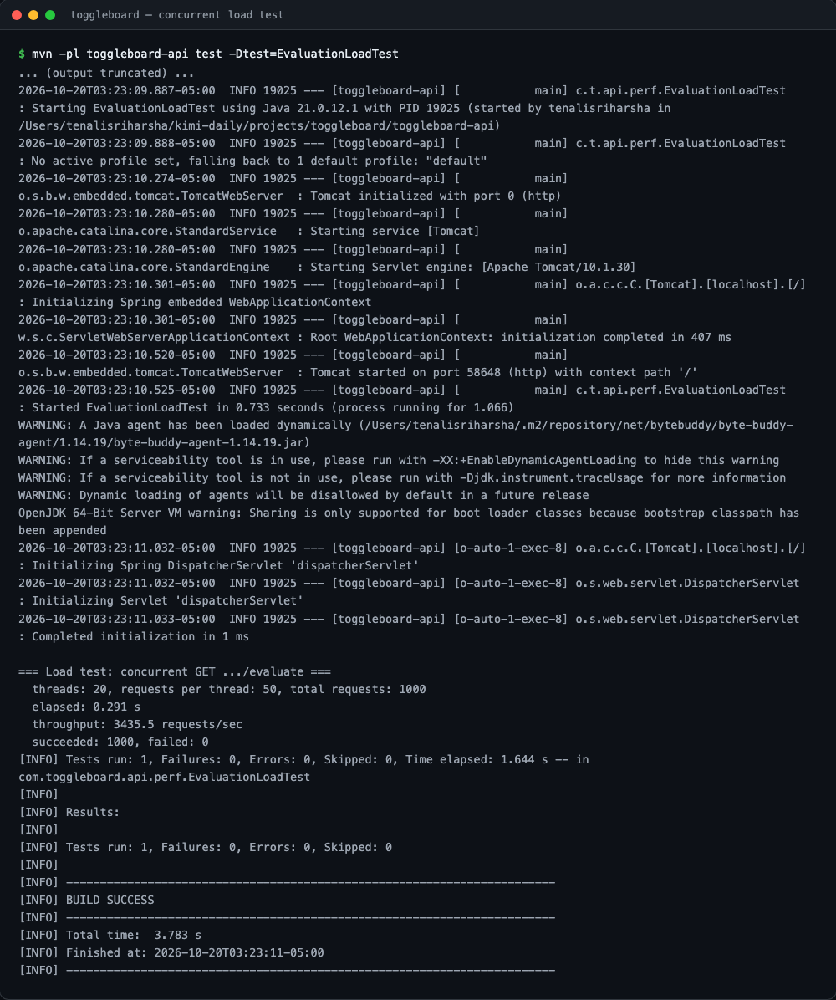

**Full test suite** — 149 tests in `toggleboard-api` plus 6 in `toggleboard-client-sdk`
(155 total), all green.

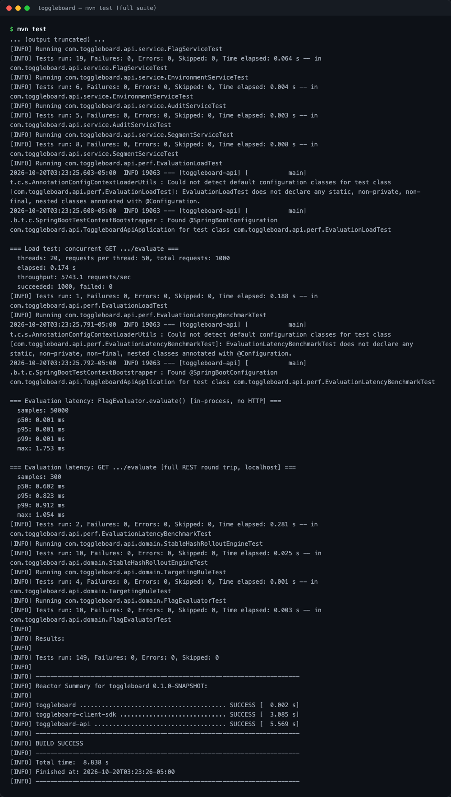

## Architecture

```
toggleboard/
├── toggleboard-api/          Spring Boot 3 REST API (flags, environments, evaluation)
│   ├── domain/                 Flag, Segment, TargetingRule, AuditEntry, FlagEvaluator
│   ├── repository/             Storage interfaces + memory/ and dynamodb/ implementations
│   ├── service/                 Business logic, validation, audit recording
│   ├── web/                    REST controllers + DTOs (including the SSE /stream endpoint)
│   ├── streaming/               FlagChangePublisher: fans out flag-change events over SSE
│   ├── security/               API-key filter (data-plane) + X-Role filter (admin CRUD)
│   └── exception/               Centralized error handling
├── toggleboard-client-sdk/   Standalone Java client: local cache, SSE push + polling fallback
├── toggleboard-console/      Angular admin console                        (Phase 4)
├── terraform/                 ECS Fargate, DynamoDB, ALB, CloudFront       (Phase 5)
└── docs/screenshots/         Preview images for this README
```

See [PROGRESS.md](PROGRESS.md) for the full breakdown of `toggleboard-api`'s internal
packages and the design decisions behind them.

## Running the API locally

Requires Java 21 and Maven. No Docker and no AWS account are needed either way.

**In-memory storage (default)** — nothing to configure:

```bash
mvn -pl toggleboard-api spring-boot:run
```

**DynamoDB-backed storage** — point it at a real DynamoDB endpoint (or a local one,
e.g. [DynamoDB Local](https://docs.aws.amazon.com/amazondynamodb/latest/developerguide/DynamoDBLocal.html)
or the embedded instance this project's own tests use). Tables are created
automatically on startup if they don't already exist:

```bash
SPRING_PROFILES_ACTIVE=dynamodb \
TOGGLEBOARD_DYNAMODB_ENDPOINT=http://localhost:8000 \
mvn -pl toggleboard-api spring-boot:run
```

Omit `TOGGLEBOARD_DYNAMODB_ENDPOINT` to use the default AWS endpoint and credential
chain for a real deployment. Both modes implement the exact same `FlagRepository` /
`EnvironmentRepository` / `SegmentRepository` / `AuditRepository` interfaces, so the
service layer is identical either way.

The API listens on `http://localhost:8080`. Swagger UI is at
`http://localhost:8080/swagger-ui.html`.

### Quick walkthrough

```bash
# Create an environment (generates its API key) — admin CRUD requires X-Role: admin
curl -s -X POST http://localhost:8080/api/v1/environments \
  -H "Content-Type: application/json" -H "X-Role: admin" \
  -d '{"key":"production","name":"Production"}'

# Create a reusable segment
curl -s -X POST http://localhost:8080/api/v1/environments/production/segments \
  -H "Content-Type: application/json" -H "X-Role: admin" \
  -d '{"key":"beta-users","name":"Beta Users","rules":[{"attribute":"beta","operator":"EQUALS","values":["true"]}]}'

# Create a boolean flag at 40% rollout, targeting US/CA directly and the segment above
curl -s -X POST http://localhost:8080/api/v1/environments/production/flags \
  -H "Content-Type: application/json" -H "X-Role: admin" \
  -d '{"key":"new-checkout-flow","name":"New Checkout Flow","type":"BOOLEAN","enabled":true,"rolloutPercentage":40,
       "targetingRules":[{"attribute":"country","operator":"IN","values":["US","CA"]}],"segmentKeys":["beta-users"]}'

# Evaluate it for a subject — extra query params become targeting attributes
curl -s "http://localhost:8080/api/v1/environments/production/flags/new-checkout-flow/evaluate?subjectKey=user-482&country=US" \
  -H "X-API-Key: <apiKey from the create-environment response>"

# See everything that happened in this environment, newest first
curl -s "http://localhost:8080/api/v1/environments/production/audit"

# Subscribe to live flag-change events (SSE) — same API key as evaluation
curl -s -N "http://localhost:8080/api/v1/environments/production/stream" \
  -H "X-API-Key: <apiKey from the create-environment response>"
```

### Role-based access control

Admin CRUD endpoints under `/api/v1/environments/**` (everything except the
`/evaluate` data-plane, which is guarded by the API key instead) read an `X-Role`
header: `GET` requests need no role at all, but a mutation (`POST`/`PUT`/`DELETE`)
requires `X-Role: admin` — a missing header is `401`, `X-Role: viewer` is `403`. This
is a lightweight placeholder ahead of real identity/authorization in a later phase.

## Client SDK

`toggleboard-client-sdk` is a standalone Java module — it depends on nothing but
Jackson for JSON and the JDK's own `java.net.http.HttpClient`, not on
`toggleboard-api`'s classes, so it can be shipped and used independently of this repo.

```java
ToggleboardClient client = ToggleboardClient.create(ToggleboardClientConfig.builder()
        .baseUrl("http://localhost:8080")
        .environmentKey("production")
        .apiKey(apiKey)
        .build());

EvaluationResult result = client.evaluate("new-checkout-flow", "user-482");
// result.enabled(), result.variantKey(), result.value(), result.reason()

client.onFlagChange(notification ->
        System.out.println("flag changed: " + notification.flagKey() + " " + notification.action()));

client.close(); // or use it in a try-with-resources block
```

Every `evaluate()` call hits the REST endpoint directly and caches the result; if that
call fails, the last cached value for the same flag/subject pair is served instead
(an exception is only thrown if there is no cached value at all). A background poller
periodically refreshes every cached entry, and — unless `streamingEnabled(false)` is
set — an SSE subscription to the server's `/stream` endpoint proactively refreshes a
flag's cached entries the moment the server reports a change, with automatic
reconnect and exponential backoff if the connection drops. See
`toggleboard-client-sdk`'s `SdkDemo` (`src/main/java/com/toggleboard/sdk/examples/`)
for a complete runnable walkthrough, and the screenshot above for its output.

## Testing

```bash
mvn test
```

149 tests in `toggleboard-api` + 6 in `toggleboard-client-sdk` (155 total):
stable-hash rollout determinism and distribution, flag evaluation (kill switch,
targeting rules, segment matching, boolean rollout, multivariate variant selection
and overrides), repository CRUD for every entity against **both** the in-memory and
the DynamoDB-backed implementations (via embedded DynamoDB Local — no Docker),
service-layer validation and audit recording, MockMvc integration tests for every
REST endpoint (including the API-key filter's and the `X-Role` filter's 401/403
paths and the SSE stream's async lifecycle), the client SDK's own tests against an
in-process JDK `HttpServer` (evaluation, caching/fallback, polling, SSE push and
reconnect — no Spring context needed), an end-to-end integration test that runs the
SDK against the real running server, and a hand-rolled evaluation-latency benchmark
and concurrent load test (see the screenshots above for sample numbers).
