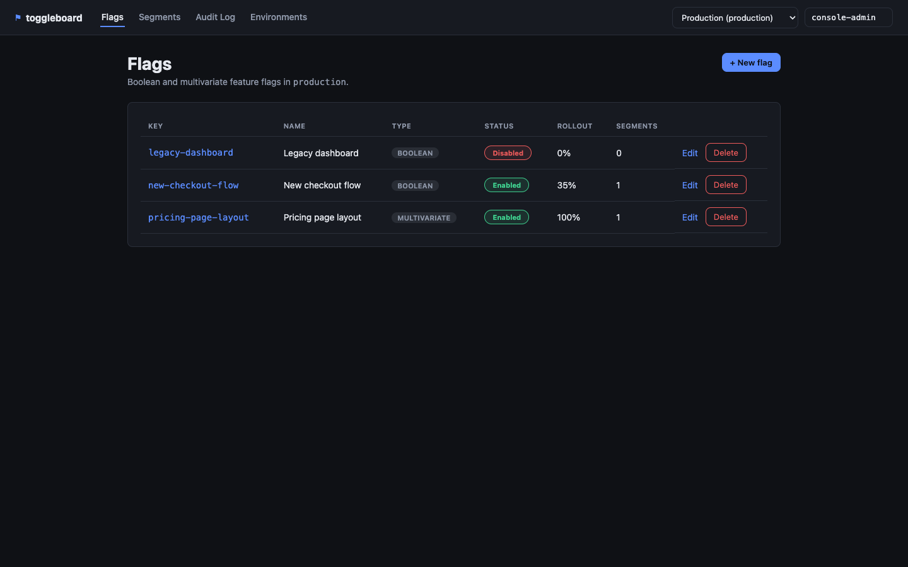
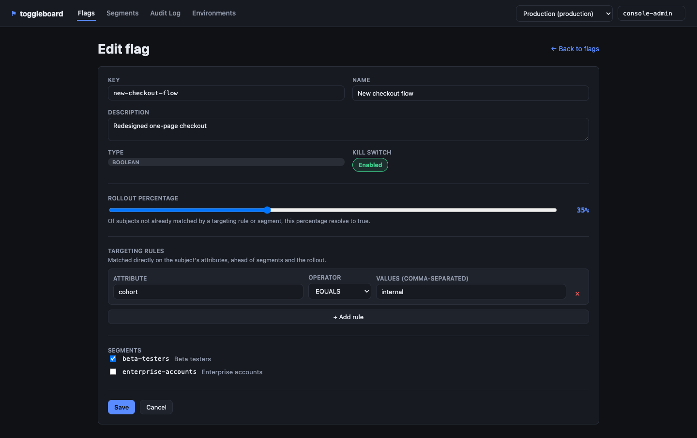
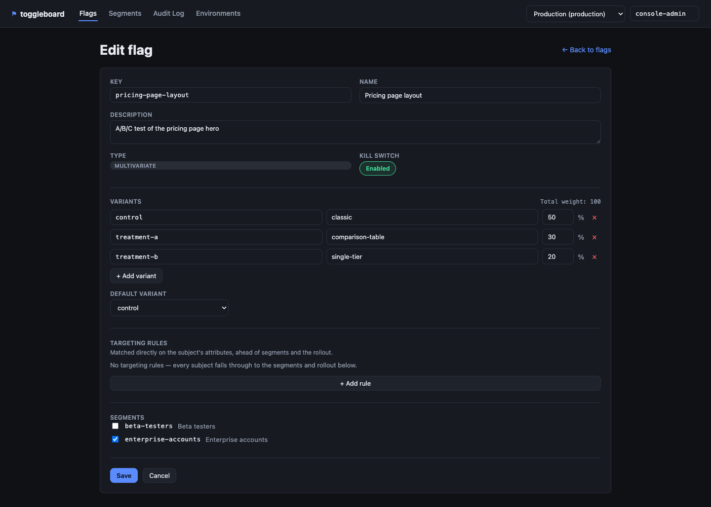
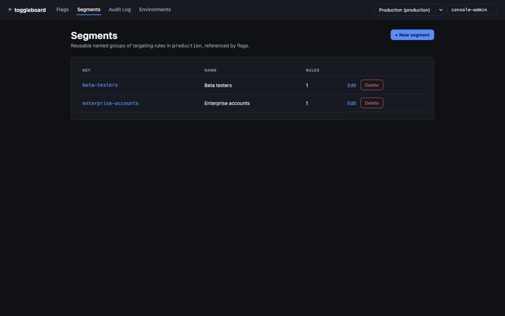
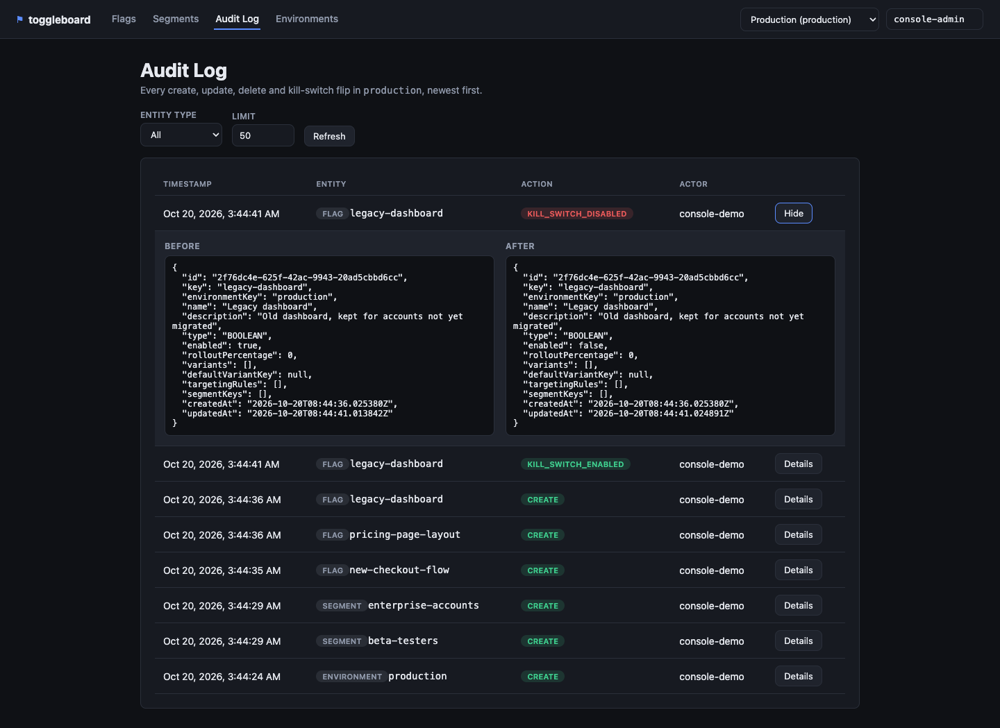
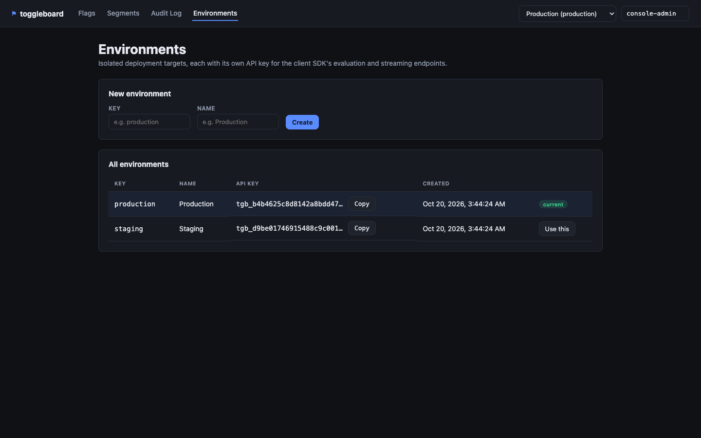
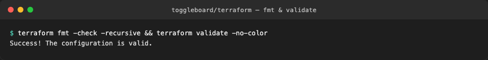
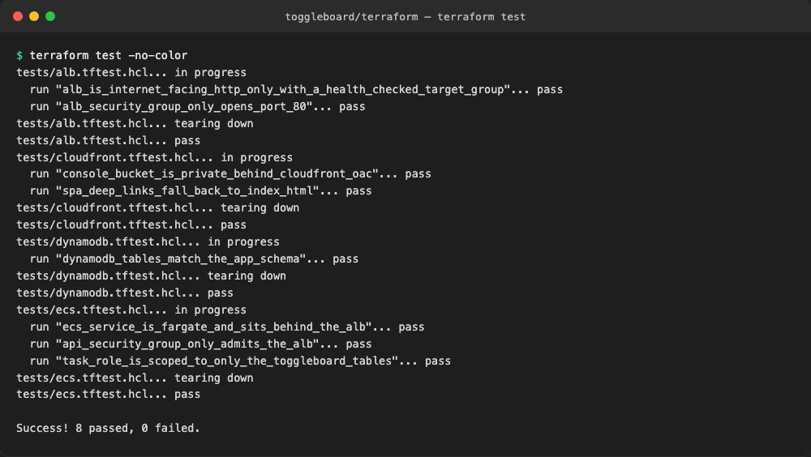
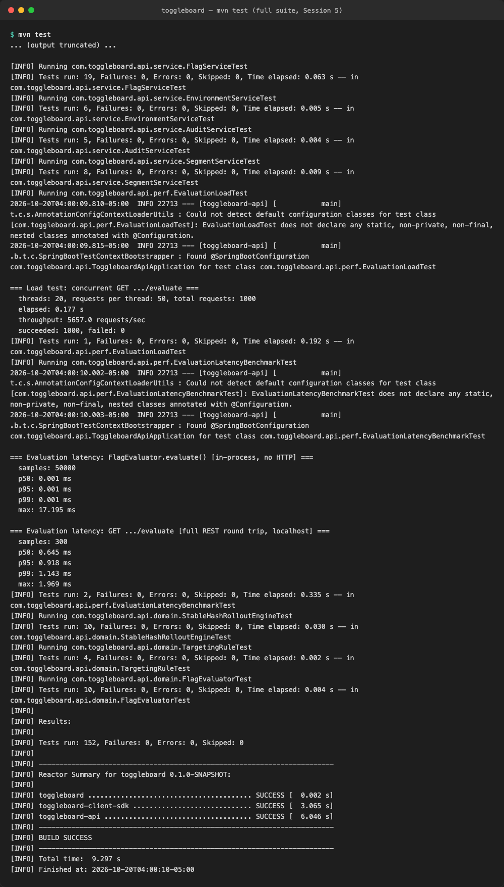

# toggleboard

A feature flag service: a Spring Boot 3 REST API backed by DynamoDB, with boolean and
multivariate flags, percentage rollouts via stable hashing, targeting rules and
segments, a kill switch, role-based access control, and a full audit history of every
change. It ships a Java client SDK with local caching and streaming updates (SSE), an
Angular admin console, per-environment API keys, OpenAPI docs, and Terraform to run it
all on AWS.

## Project Status

Built in public across a 5-session sprint — **all 5 sessions complete.** See
[PROGRESS.md](PROGRESS.md) for the full architecture and phased build plan, and
[DAILY_REPORT.md](DAILY_REPORT.md) for a summary of what was built, final test
results, known limitations, and future ideas.

**Session 1 of 5 — Foundation: done.** Core domain model, stable-hash rollout engine,
in-memory storage behind repository interfaces, the flags/environments REST API,
per-environment API key auth on the evaluation endpoint, OpenAPI docs, and 56 passing
tests.

**Session 2 of 5 — Persistence, targeting & audit: done.** A real DynamoDB-backed
`FlagRepository`/`EnvironmentRepository`/`SegmentRepository`/`AuditRepository`
(switchable via the `dynamodb` Spring profile, same interfaces the in-memory repos
implement), targeting rules and reusable segments evaluated ahead of the percentage
rollout, a full audit log of every create/update/delete/kill-switch-toggle, a
lightweight `X-Role` RBAC layer on the admin CRUD endpoints, and 131 passing tests
(including real round-trips against embedded DynamoDB Local — no Docker required).

**Session 3 of 5 — Client SDK & performance: done.** A standalone `toggleboard-client-sdk`
Java module (only Jackson + the JDK's own `java.net.http.HttpClient` — no dependency on
`toggleboard-api`'s classes) that evaluates flags, caches results locally, and keeps
them fresh via a background poller and an SSE subscription with automatic reconnect;
a new `/stream` SSE endpoint on the server that pushes a `flag-change` event on every
create/update/delete; a hand-rolled p50/p99 evaluation-latency benchmark (both
in-process and full REST round trip); and a concurrent load test against the
evaluation endpoint. 149 tests in `toggleboard-api` + 6 in `toggleboard-client-sdk`
(155 total), including a real end-to-end integration test that runs the SDK against
the actual running server.

**Session 4 of 5 — Angular admin console: done.** A standalone `toggleboard-console`
Angular 19 app (standalone components, no NgModules) that talks to `toggleboard-api`'s
admin CRUD endpoints directly from the browser: a flags list with an inline kill-switch
toggle, a create/edit form with a rollout-percentage slider, a variant editor with a
live weight-sum check, a shared targeting-rules editor (reused for both flags and
segments), a segment picker, a segments list and editor, an audit log viewer with
expandable before/after JSON diffs, and an environments screen to create environments
and copy their API keys. A `CorsRegistry` bean on the API now allows the console's dev
server to call it directly. 151 tests in `toggleboard-api` (new: a CORS preflight test)
+ 6 in `toggleboard-client-sdk` + 38 in `toggleboard-console` (195 total).

**Session 5 of 5 — Infrastructure & final polish: done.** `terraform/` provisions
toggleboard-api on ECS Fargate behind an ALB, the four DynamoDB tables (matching
`DynamoDbTableInitializer`'s schema exactly), and S3 + CloudFront serving the Angular
console's static build — validated with `terraform fmt`/`validate` and a `terraform
test` suite (8 assertions across 4 files) against `mock_provider`, since no real AWS
account exists in this environment. Also adds `spring-boot-starter-actuator` exposing
only `GET /actuator/health` (no auth) for the ALB's target-group health check. 152
tests in `toggleboard-api` (new: the health-endpoint test) + 6 in
`toggleboard-client-sdk` + 38 in `toggleboard-console` (196 total), all green, plus the
8 Terraform test assertions.

## Preview

**Swagger / OpenAPI docs** — every endpoint is documented and callable from the browser.


**Evaluation endpoint detail** — the client SDK data-plane: resolve a flag for a subject.


**Creating an environment and a flag** — environments get an auto-generated API key;
flags are created with a rollout percentage.


**Listing flags** — boolean, multivariate (with weighted variants), and a
kill-switched flag, all in one environment.


**Evaluation, API key auth, and the kill switch** — a valid key gets a decision, a
missing key is rejected with 401, and a disabled flag always resolves to `false`
regardless of its rollout percentage.


**Stable-hash rollout in action** — 500 distinct subjects evaluated against a flag
with `rolloutPercentage=40`; the observed rate lands within a couple points of target.


**Targeting rules and segments** — a reusable segment, and a flag that targets
`country IN [US, CA]` directly and also references that segment.


**Evaluation reasons** — the same flag resolving three different ways for three
different subjects: a direct targeting-rule match, a segment match, and the default
rollout fallback when neither matches.


**Kill switch toggle and the audit log** — disabling a flag records a
`KILL_SWITCH_DISABLED` entry (not just a generic update) with who did it and the
full before/after snapshot.


**Role-based access control** — a mutating request with no `X-Role` header is
rejected with 401, a `viewer` gets 403, an `admin` succeeds, and reads never require
a role at all.


**Full test suite** — 131 tests across the domain, repository (in-memory and
DynamoDB), service, and web layers.


**Running on the `dynamodb` profile** — the exact same API, backed by a real
DynamoDB client instead of the in-memory repositories.


**The client SDK end-to-end** — `toggleboard-client-sdk`'s `SdkDemo` creates an
environment and flag through the admin API, evaluates the flag through the SDK, then
watches a live SSE push notification arrive the instant an admin flips the kill
switch — the cache refreshes itself automatically, no explicit poll needed.


**Evaluation-latency benchmark** — p50/p99 for `FlagEvaluator.evaluate()` directly
(sub-microsecond) versus the full REST round trip over localhost (sub-millisecond).


**Concurrent load test** — 20 threads firing 1,000 requests at `/evaluate` with zero
failures.


**Full test suite** — 149 tests in `toggleboard-api` plus 6 in `toggleboard-client-sdk`
(155 total), all green.


**Admin console — flags list** — every flag in an environment with its type, an
inline kill-switch toggle, rollout percentage, and how many segments it references.



**Admin console — editing a boolean flag** — the rollout-percentage slider and the
shared targeting-rules editor, with the flag's referenced segments checked below.



**Admin console — editing a multivariate flag** — the variant editor with a live
weight-sum check (must total 100) and a default-variant picker.



**Admin console — segments** — the same reusable, named targeting-rule groups the
API exposes, listed and ready to edit or reference from a flag.



**Admin console — audit log** — every create, update, delete and kill-switch flip,
with an expandable before/after JSON diff for the selected entry.



**Admin console — environments** — create an environment, see its generated API key,
and switch which environment the rest of the console is pointed at.



**Terraform — `fmt` and `validate`** — the ECS Fargate / DynamoDB / ALB / CloudFront
module passes both with zero formatting diffs.



**Terraform — `terraform test`** — 8 assertions across 4 test files, run against
`mock_provider` so no real AWS account is ever touched: DynamoDB table/GSI shapes,
the ECS service's Fargate config and its IAM task role scoped to only the four
toggleboard tables, the ALB's listener/health-check config, and the console's
CloudFront distribution (private S3 behind OAC, SPA deep-link fallback).



**Full test suite, final run** — 152 tests in `toggleboard-api` (up from 149: the new
health-endpoint test) plus 6 in `toggleboard-client-sdk` (158 total), all green.



## Architecture

```
toggleboard/
├── toggleboard-api/          Spring Boot 3 REST API (flags, environments, evaluation)
│   ├── domain/                 Flag, Segment, TargetingRule, AuditEntry, FlagEvaluator
│   ├── repository/             Storage interfaces + memory/ and dynamodb/ implementations
│   ├── service/                 Business logic, validation, audit recording
│   ├── web/                    REST controllers + DTOs (including the SSE /stream endpoint)
│   ├── streaming/               FlagChangePublisher: fans out flag-change events over SSE
│   ├── security/               API-key filter (data-plane) + X-Role filter (admin CRUD)
│   ├── config/                  Domain beans, DynamoDB client, CORS for the console's dev server
│   └── exception/               Centralized error handling
├── toggleboard-client-sdk/   Standalone Java client: local cache, SSE push + polling fallback
├── toggleboard-console/      Angular admin console: flags, segments, audit log, environments
│   └── src/app/
│       ├── core/                ApiService, EnvironmentContextService, admin-headers interceptor
│       ├── shared/               TargetingRulesEditorComponent (flags + segments both use it)
│       └── features/             flags/, segments/, audit/, environments/ — one route each
├── terraform/                 ECS Fargate, DynamoDB, ALB, CloudFront for the console
└── docs/screenshots/         Preview images for this README
```

See [PROGRESS.md](PROGRESS.md) for the full breakdown of `toggleboard-api`'s internal
packages and the design decisions behind them.

## Running the API locally

Requires Java 21 and Maven. No Docker and no AWS account are needed either way.

**In-memory storage (default)** — nothing to configure:

```bash
mvn -pl toggleboard-api spring-boot:run
```

**DynamoDB-backed storage** — point it at a real DynamoDB endpoint (or a local one,
e.g. [DynamoDB Local](https://docs.aws.amazon.com/amazondynamodb/latest/developerguide/DynamoDBLocal.html)
or the embedded instance this project's own tests use). Tables are created
automatically on startup if they don't already exist:

```bash
SPRING_PROFILES_ACTIVE=dynamodb \
TOGGLEBOARD_DYNAMODB_ENDPOINT=http://localhost:8000 \
mvn -pl toggleboard-api spring-boot:run
```

Omit `TOGGLEBOARD_DYNAMODB_ENDPOINT` to use the default AWS endpoint and credential
chain for a real deployment. Both modes implement the exact same `FlagRepository` /
`EnvironmentRepository` / `SegmentRepository` / `AuditRepository` interfaces, so the
service layer is identical either way.

The API listens on `http://localhost:8080`. Swagger UI is at
`http://localhost:8080/swagger-ui.html`.

### Quick walkthrough

```bash
# Create an environment (generates its API key) — admin CRUD requires X-Role: admin
curl -s -X POST http://localhost:8080/api/v1/environments \
  -H "Content-Type: application/json" -H "X-Role: admin" \
  -d '{"key":"production","name":"Production"}'

# Create a reusable segment
curl -s -X POST http://localhost:8080/api/v1/environments/production/segments \
  -H "Content-Type: application/json" -H "X-Role: admin" \
  -d '{"key":"beta-users","name":"Beta Users","rules":[{"attribute":"beta","operator":"EQUALS","values":["true"]}]}'

# Create a boolean flag at 40% rollout, targeting US/CA directly and the segment above
curl -s -X POST http://localhost:8080/api/v1/environments/production/flags \
  -H "Content-Type: application/json" -H "X-Role: admin" \
  -d '{"key":"new-checkout-flow","name":"New Checkout Flow","type":"BOOLEAN","enabled":true,"rolloutPercentage":40,
       "targetingRules":[{"attribute":"country","operator":"IN","values":["US","CA"]}],"segmentKeys":["beta-users"]}'

# Evaluate it for a subject — extra query params become targeting attributes
curl -s "http://localhost:8080/api/v1/environments/production/flags/new-checkout-flow/evaluate?subjectKey=user-482&country=US" \
  -H "X-API-Key: <apiKey from the create-environment response>"

# See everything that happened in this environment, newest first
curl -s "http://localhost:8080/api/v1/environments/production/audit"

# Subscribe to live flag-change events (SSE) — same API key as evaluation
curl -s -N "http://localhost:8080/api/v1/environments/production/stream" \
  -H "X-API-Key: <apiKey from the create-environment response>"
```

### Role-based access control

Admin CRUD endpoints under `/api/v1/environments/**` (everything except the
`/evaluate` data-plane, which is guarded by the API key instead) read an `X-Role`
header: `GET` requests need no role at all, but a mutation (`POST`/`PUT`/`DELETE`)
requires `X-Role: admin` — a missing header is `401`, `X-Role: viewer` is `403`. This
is a lightweight placeholder ahead of real identity/authorization in a later phase.

## Admin console

`toggleboard-console` is an Angular 19 app (standalone components, no NgModules) that
talks to `toggleboard-api`'s admin CRUD endpoints directly from the browser — it never
touches the client-SDK data-plane (`/evaluate`, `/stream`), so it never needs an API
key. Every mutating request is automatically sent with `X-Role: admin` and an
`X-Actor` header (editable in the top bar, so the audit log can tell console changes
apart from each other) via an HTTP interceptor; the API's `CorsRegistry` bean allows
the console's dev-server origins (`localhost:4200` / `127.0.0.1:4200`).

Requires Node and npm. With `toggleboard-api` already running on `localhost:8080`
(see above):

```bash
cd toggleboard-console
npm install
npm start   # ng serve — http://localhost:4200
```

The console has no environment of its own to start with — the **Environments** page
lets you create one and copy its generated API key (handy for pointing a `curl` call
or the client SDK at it), and an environment switcher in the top bar controls which
environment the rest of the console (flags, segments, audit log) is scoped to.

## Client SDK

`toggleboard-client-sdk` is a standalone Java module — it depends on nothing but
Jackson for JSON and the JDK's own `java.net.http.HttpClient`, not on
`toggleboard-api`'s classes, so it can be shipped and used independently of this repo.

```java
ToggleboardClient client = ToggleboardClient.create(ToggleboardClientConfig.builder()
        .baseUrl("http://localhost:8080")
        .environmentKey("production")
        .apiKey(apiKey)
        .build());

EvaluationResult result = client.evaluate("new-checkout-flow", "user-482");
// result.enabled(), result.variantKey(), result.value(), result.reason()

client.onFlagChange(notification ->
        System.out.println("flag changed: " + notification.flagKey() + " " + notification.action()));

client.close(); // or use it in a try-with-resources block
```

Every `evaluate()` call hits the REST endpoint directly and caches the result; if that
call fails, the last cached value for the same flag/subject pair is served instead
(an exception is only thrown if there is no cached value at all). A background poller
periodically refreshes every cached entry, and — unless `streamingEnabled(false)` is
set — an SSE subscription to the server's `/stream` endpoint proactively refreshes a
flag's cached entries the moment the server reports a change, with automatic
reconnect and exponential backoff if the connection drops. See
`toggleboard-client-sdk`'s `SdkDemo` (`src/main/java/com/toggleboard/sdk/examples/`)
for a complete runnable walkthrough, and the screenshot above for its output.

## Infrastructure

`terraform/` provisions toggleboard on AWS: `toggleboard-api` on ECS Fargate behind
an internet-facing ALB (target group health-checking `GET /actuator/health`), the
four DynamoDB tables with the same names/keys/GSIs `DynamoDbTableInitializer` creates
at runtime, and a private S3 bucket + CloudFront distribution (Origin Access Control,
SPA deep-link fallback to `index.html`) serving `toggleboard-console`'s static build.
The ECS task role is scoped to exactly those four tables — no `"Resource": "*"`.

**No real AWS account exists in this project's environment — only dummy
credentials.** The module is validated with `terraform fmt`/`validate` (both run
clean, no formatting diffs) and a `terraform test` suite (`terraform/tests/*.tftest.hcl`)
run against `mock_provider`, which exercises the full plan/apply graph without ever
calling real AWS:

```bash
cd terraform
terraform init
terraform fmt -check -recursive
terraform validate
terraform test
```

See [terraform/README.md](terraform/README.md) for the full file-by-file breakdown
and what each test asserts.

## Testing

```bash
mvn test                                    # toggleboard-api + toggleboard-client-sdk
cd toggleboard-console && npm test -- --watch=false --browsers=ChromeHeadless
cd terraform && terraform test              # infrastructure, against mock_provider
```

152 tests in `toggleboard-api` + 6 in `toggleboard-client-sdk` + 38 in
`toggleboard-console` (196 total), plus 8 Terraform test assertions:

- **`toggleboard-api`**: stable-hash rollout determinism and distribution, flag
  evaluation (kill switch, targeting rules, segment matching, boolean rollout,
  multivariate variant selection and overrides), repository CRUD for every entity
  against **both** the in-memory and the DynamoDB-backed implementations (via embedded
  DynamoDB Local — no Docker), service-layer validation and audit recording, MockMvc
  integration tests for every REST endpoint (including the API-key filter's and the
  `X-Role` filter's 401/403 paths, the SSE stream's async lifecycle, and the CORS
  preflight the console's dev server relies on), a hand-rolled evaluation-latency
  benchmark and concurrent load test (see the screenshots above for sample numbers),
  and that `GET /actuator/health` is reachable with no auth for the ALB health check.
- **`toggleboard-client-sdk`**: its own tests against an in-process JDK `HttpServer`
  (evaluation, caching/fallback, polling, SSE push and reconnect — no Spring context
  needed), plus an end-to-end integration test (in `toggleboard-api`) that runs the
  SDK against the real running server.
- **`toggleboard-console`**: Karma/Jasmine unit tests (headless Chrome) for every
  component and service — API URL construction, the environment-context service's
  current-environment and actor persistence, the shared targeting-rules editor's
  add/remove/value-parsing logic, each feature's form validation (e.g. a multivariate
  flag whose variant weights don't sum to 100 is rejected before the API is even
  called) and its HTTP interactions, mocked with `provideHttpClientTesting()`.
- **`terraform`**: a `terraform test` suite (`mock_provider`, no real AWS calls) that
  asserts the DynamoDB tables' keys/GSIs match the app's own schema, the ECS service
  is genuinely Fargate with its task role scoped to only those four tables, the ALB's
  listener/health-check/security-group config, and that the console's CloudFront
  distribution is private-behind-OAC with a working SPA fallback.
