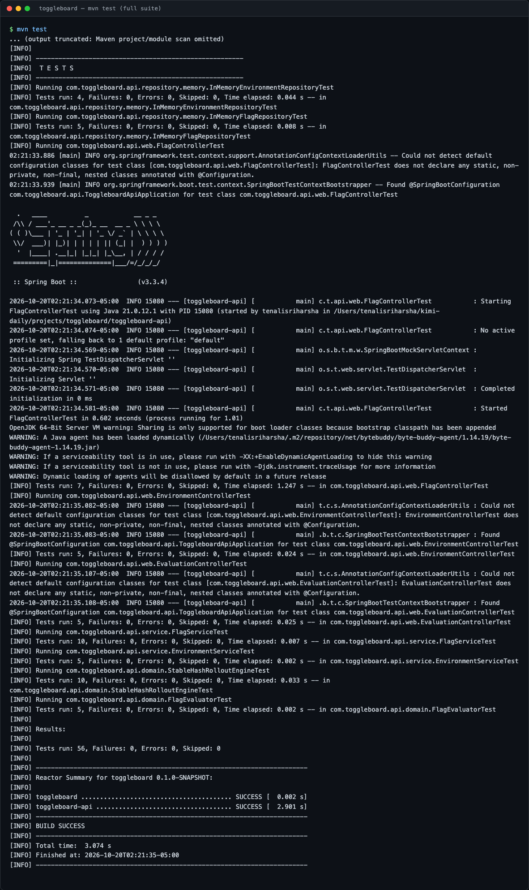

# toggleboard

A feature flag service: a Spring Boot 3 REST API backed by DynamoDB, with boolean and
multivariate flags, percentage rollouts via stable hashing, targeting rules, a kill
switch, and a full audit history of every change. It ships a Java client SDK with
local caching and streaming updates (SSE), an Angular admin console, per-environment
API keys, OpenAPI docs, and Terraform to run it all on AWS.

## Project Status

Built in public across a 5-session sprint. See [PROGRESS.md](PROGRESS.md) for the
full architecture, phased build plan, and exactly where work resumes next session.

**Session 1 of 5 — Foundation: done.** Core domain model, stable-hash rollout engine,
in-memory storage behind repository interfaces, the flags/environments REST API,
per-environment API key auth on the evaluation endpoint, OpenAPI docs, and 56 passing
tests.

## Preview

**Swagger / OpenAPI docs** — every endpoint is documented and callable from the browser.


**Evaluation endpoint detail** — the client SDK data-plane: resolve a flag for a subject.


**Creating an environment and a flag** — environments get an auto-generated API key;
flags are created with a rollout percentage.


**Listing flags** — boolean, multivariate (with weighted variants), and a
kill-switched flag, all in one environment.


**Evaluation, API key auth, and the kill switch** — a valid key gets a decision, a
missing key is rejected with 401, and a disabled flag always resolves to `false`
regardless of its rollout percentage.


**Stable-hash rollout in action** — 500 distinct subjects evaluated against a flag
with `rolloutPercentage=40`; the observed rate lands within a couple points of target.


**Full test suite** — 56 tests across the domain, repository, service, and web layers.



## Architecture

```
toggleboard/
├── toggleboard-api/          Spring Boot 3 REST API (flags, environments, evaluation)
├── toggleboard-client-sdk/   Java client: local cache + SSE streaming     (Phase 3)
├── toggleboard-console/      Angular admin console                        (Phase 4)
├── terraform/                 ECS Fargate, DynamoDB, ALB, CloudFront       (Phase 5)
└── docs/screenshots/         Preview images for this README
```

See [PROGRESS.md](PROGRESS.md) for the full breakdown of `toggleboard-api`'s internal
packages and the design decisions behind them.

## Running the API locally

Requires Java 21 and Maven. No Docker, no AWS account, and no external services are
needed — storage is in-memory for now (DynamoDB arrives in Phase 2).

```bash
mvn -pl toggleboard-api spring-boot:run
```

The API listens on `http://localhost:8080`. Swagger UI is at
`http://localhost:8080/swagger-ui.html`.

### Quick walkthrough

```bash
# Create an environment (generates its API key)
curl -s -X POST http://localhost:8080/api/v1/environments \
  -H "Content-Type: application/json" \
  -d '{"key":"production","name":"Production"}'

# Create a boolean flag at 40% rollout
curl -s -X POST http://localhost:8080/api/v1/environments/production/flags \
  -H "Content-Type: application/json" \
  -d '{"key":"new-checkout-flow","name":"New Checkout Flow","type":"BOOLEAN","enabled":true,"rolloutPercentage":40}'

# Evaluate it for a subject (requires the environment's API key)
curl -s "http://localhost:8080/api/v1/environments/production/flags/new-checkout-flow/evaluate?subjectKey=user-482" \
  -H "X-API-Key: <apiKey from the create-environment response>"
```

## Testing

```bash
mvn test
```

56 tests: stable-hash rollout determinism and distribution, flag evaluation (kill
switch, boolean rollout, multivariate variant selection), repository CRUD, service
validation, and MockMvc integration tests for every REST endpoint — including the
API key filter's 401/403 paths.
